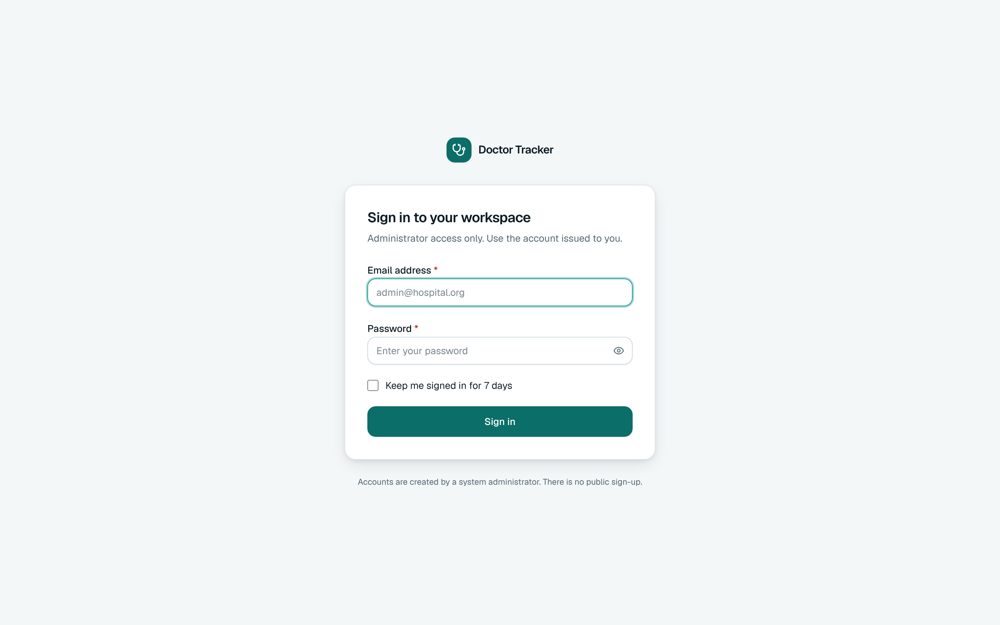
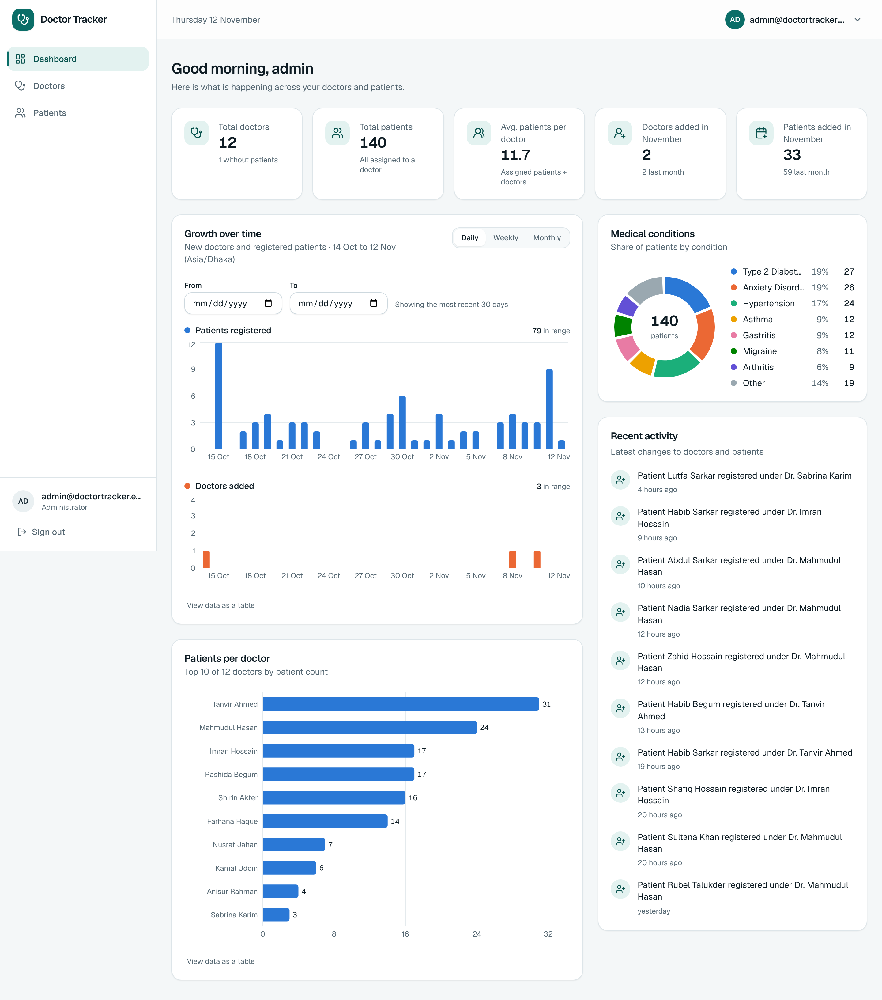
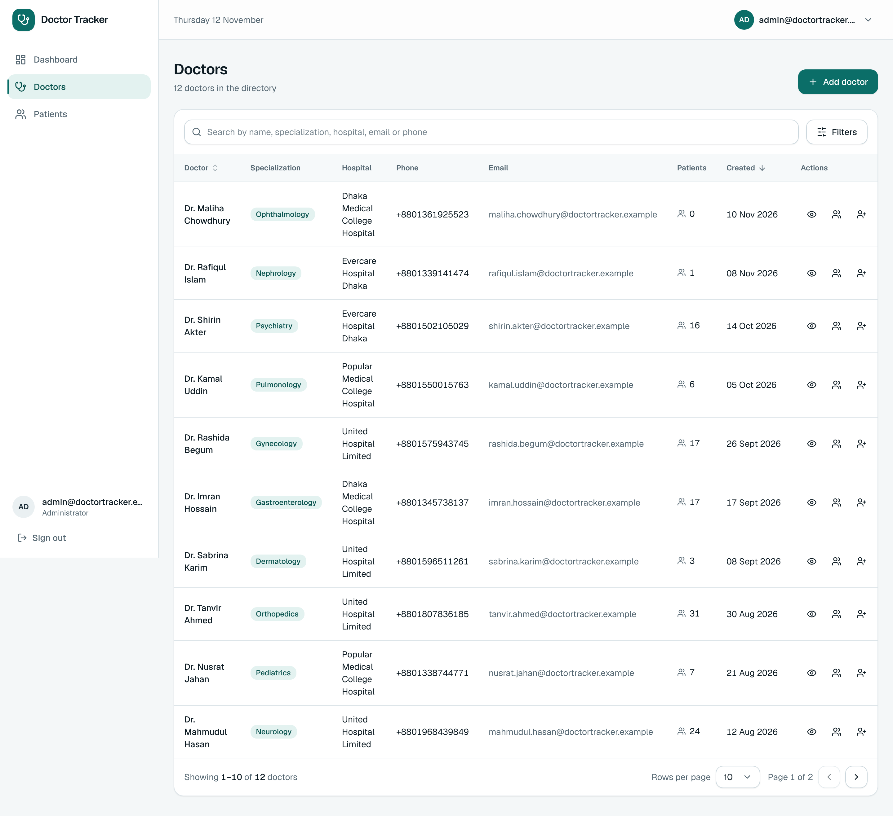
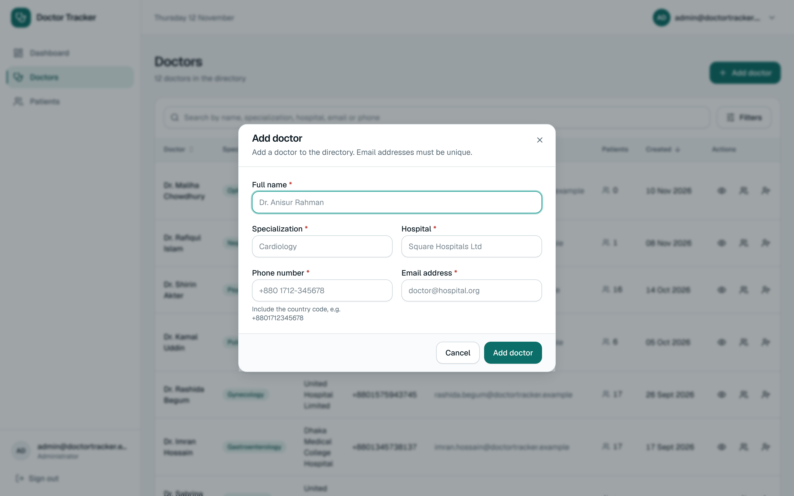
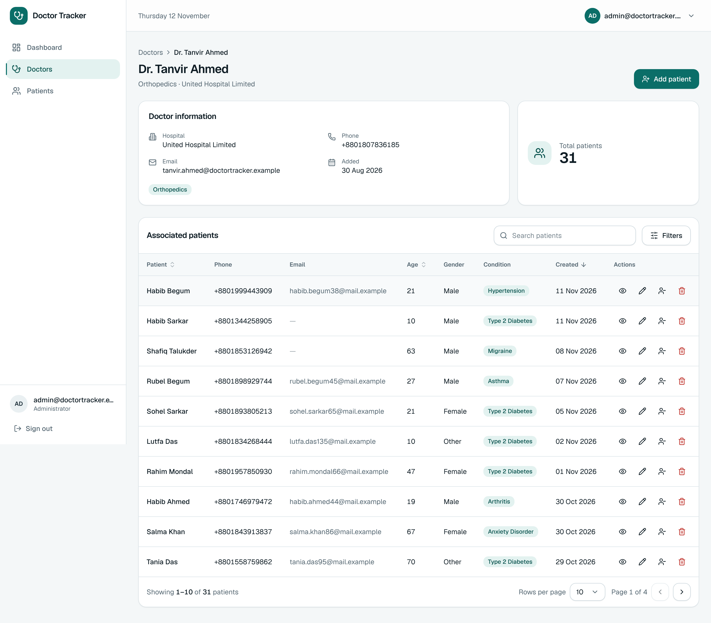
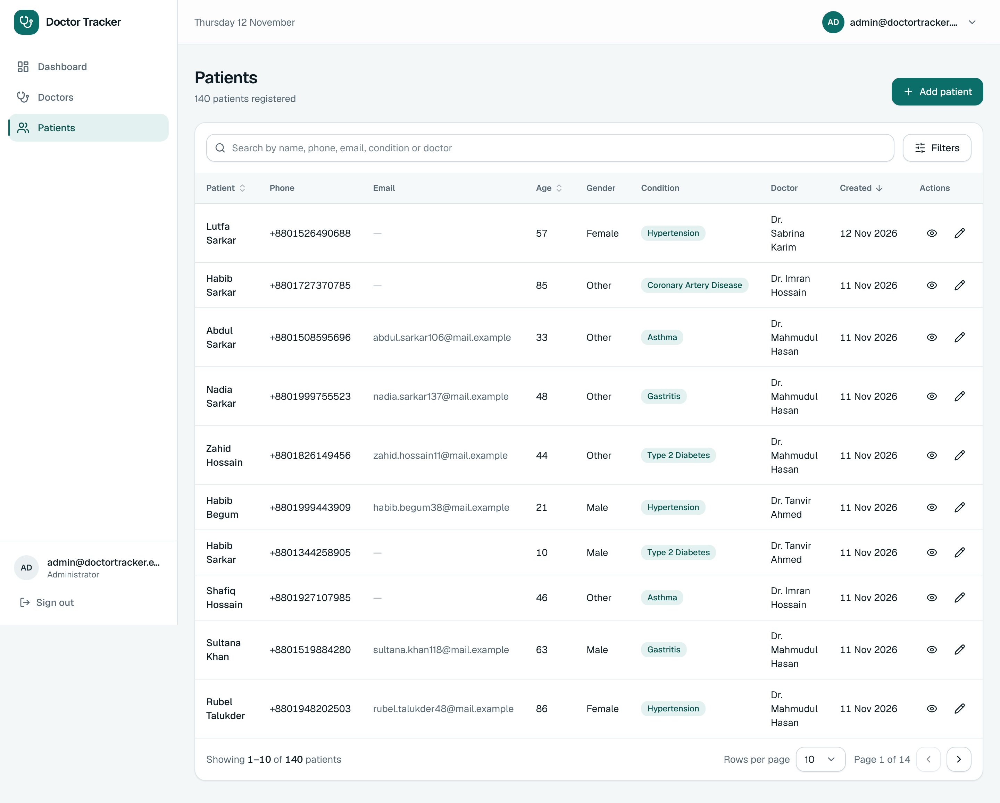
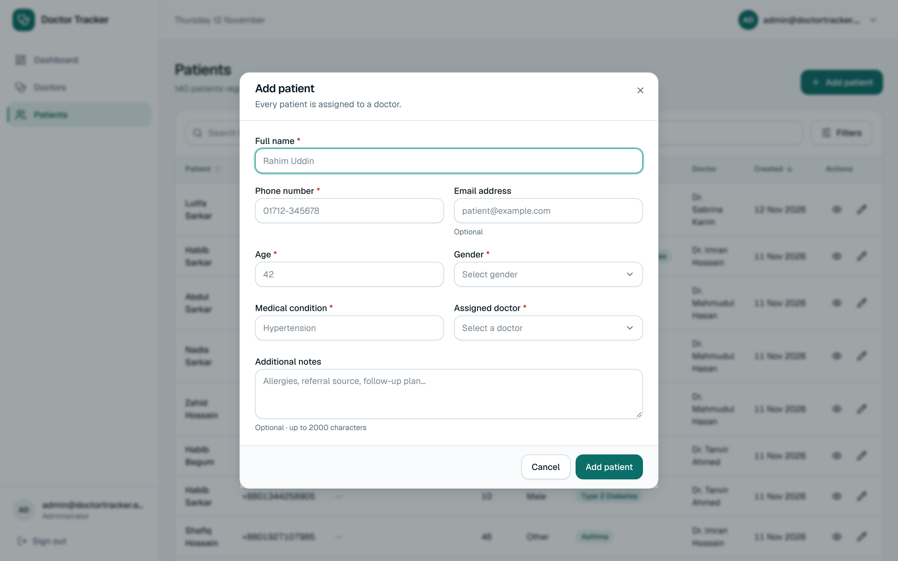
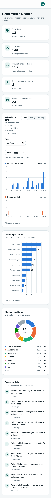
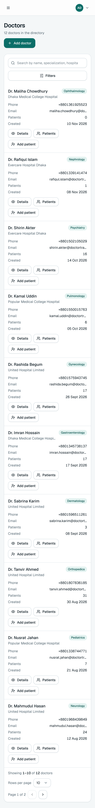

# Doctor Tracker: Frontend (Next.js)

Standalone Next.js (App Router) + TypeScript + Tailwind CSS client. It talks to the separate **doctor-tracker-backend** REST API only through HTTP. It has no Next.js API routes and no Server Actions, and it never touches the database.

## Requirements
- Node.js 22+, npm 10+
- The backend running (default `http://localhost:4000`)

## Quick start
```bash
npm install
cp .env.example .env.local     # Windows: copy .env.example .env.local
# NEXT_PUBLIC_API_URL must point at the backend, e.g. http://localhost:4000/api/v1
npm run dev                    # http://localhost:3000
```
Production: `npm run build` then `npm start`. `NEXT_PUBLIC_API_URL` is read at **build** time, so set it before building.

Log in with the administrator created by the backend's `npm run seed`.

## Environment variables
| Variable | Purpose | Default |
|---|---|---|
| `NEXT_PUBLIC_API_URL` | Base URL of the backend REST API, including `/api/v1` | `http://localhost:4000/api/v1` |

The backend's `FRONTEND_URL` must equal the address this app is served from, otherwise the browser's cookie and CSRF checks fail (403).

## Scripts
| Command | Purpose |
|---|---|
| `npm run dev` | development server |
| `npm run build` / `npm start` | production build and server |
| `npm run typecheck`, `npm run lint` | static checks |
| `npm test` | 32 component tests (Vitest + React Testing Library) |
| `npm run test:e2e` | Playwright workflow against a running backend and this app |

## Structure
```
src/app/          routes: (auth)/login, (dashboard)/dashboard | doctors | doctors/[id] | patients
src/components/   ui · shared · layout · auth · doctors · patients · dashboard
src/features/     TanStack Query hooks per domain
src/lib/          axios client (cookies, CSRF header, single-flight refresh), zod schemas, query keys
src/providers/    auth and query providers
tests/            component tests        e2e/  Playwright workflow
```

## Features

**Authentication** – administrator login with email and password; access and refresh tokens in HttpOnly cookies; refresh-token rotation with reuse detection; "keep me signed in" option; logout that revokes the session; protected pages; no public registration (the administrator is created by a seed script).

**Doctors** – create, list, search (name, specialization, hospital, email, phone), filter (specialization, hospital), sort, paginate, view details with the associated patients. There is intentionally no doctor update or delete.

**Patients** – create, list, view, edit, delete (with confirmation); search (including by assigned doctor's name); filter by doctor, gender, condition and age range; sort; paginate. A patient can be added from a doctor's page (doctor pre-selected) or removed from a doctor, which leaves the patient *Unassigned*.

**Dashboard** – total doctors and patients, average patients per doctor, additions this month versus last month, patients per doctor, growth over time (daily, weekly or monthly, with a custom date range), medical-condition distribution and recent activity. Every figure comes from a MongoDB aggregation, never from hard-coded data. Each chart has a "view data as a table" option.

**Interface** – responsive down to phone width (tables become cards), loading skeletons, empty and error states, toast notifications, confirmation dialogs, keyboard and screen-reader support, list state kept in the URL so searches survive reload and can be shared.

## Screenshots

Captured from the running application with demo data (`seed:demo`).

| | |
|---|---|
|  **Login** |  **Dashboard (desktop)** |
|  **Doctor list** |  **Add doctor** |
|  **Doctor details with patients** |  **Patient list** |
|  **Add patient** | |

Mobile (390 px wide):

| Dashboard | Doctors |
|---|---|
|  |  |

## How the client handles authentication
Tokens live in HttpOnly cookies set by the API; nothing is stored in `localStorage`. The Axios client sends cookies with every request, adds the `X-CSRF-Token` header from an in-memory copy, and on a 401 performs one shared refresh and retries the request. Page guards are a user-experience layer; the API enforces authentication on every call.

## Testing
```bash
npm test
# end-to-end (backend running and seeded, app built and started):
npx playwright install chromium
E2E_ADMIN_EMAIL=you@example.com E2E_ADMIN_PASSWORD='your password' npm run test:e2e
# optional: E2E_BASE_URL (default http://localhost:3000), PLAYWRIGHT_CHROMIUM_PATH
```
Last run: **32 component tests passed, 0 failed; 1 end-to-end workflow passed, 0 failed**. Typecheck, lint and production build are clean. The end-to-end test creates a uniquely named doctor on each run and deletes only the patient it created.

## Known limitations
- The shadcn/ui components were written by hand following the shadcn patterns because the registry was unreachable while building.
- Light theme only.
- The patient form's doctor dropdown loads up to 100 doctors.
- Single end-to-end workflow, Chromium only.
